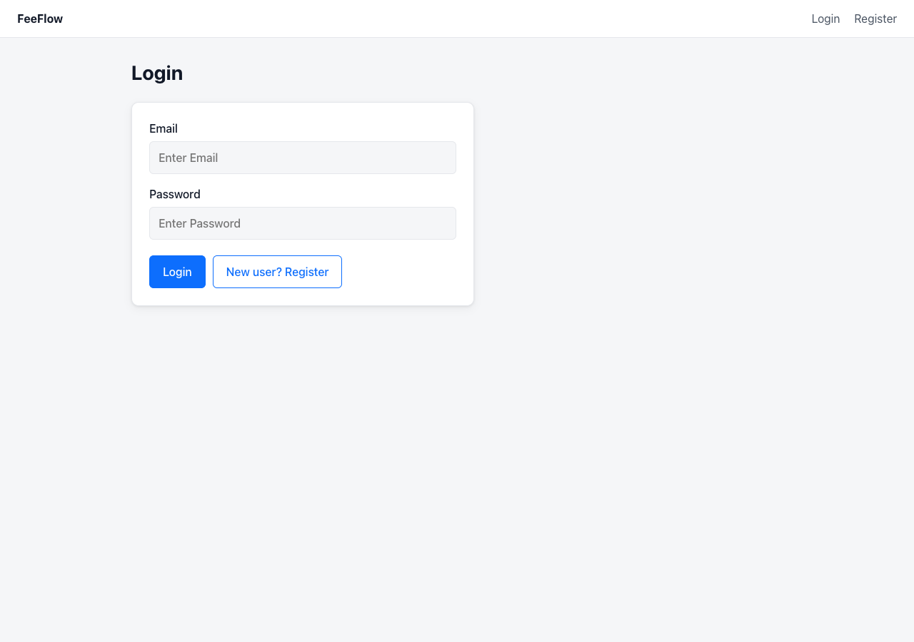
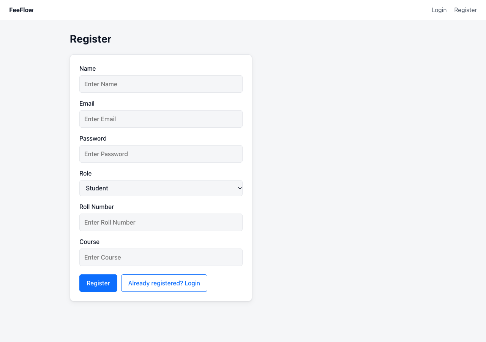
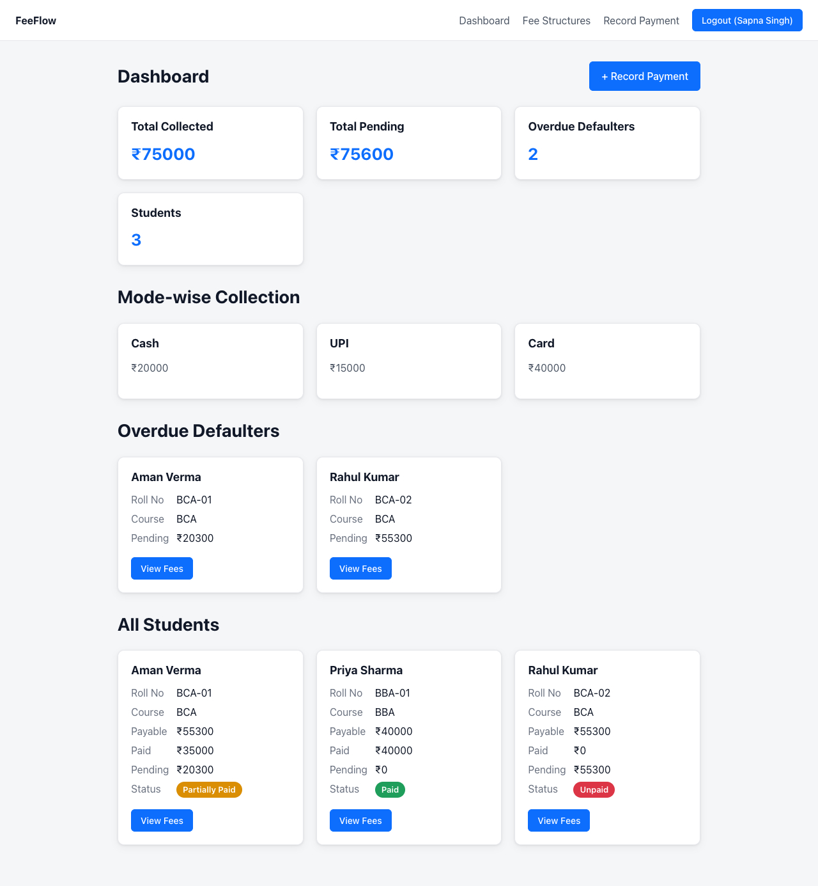
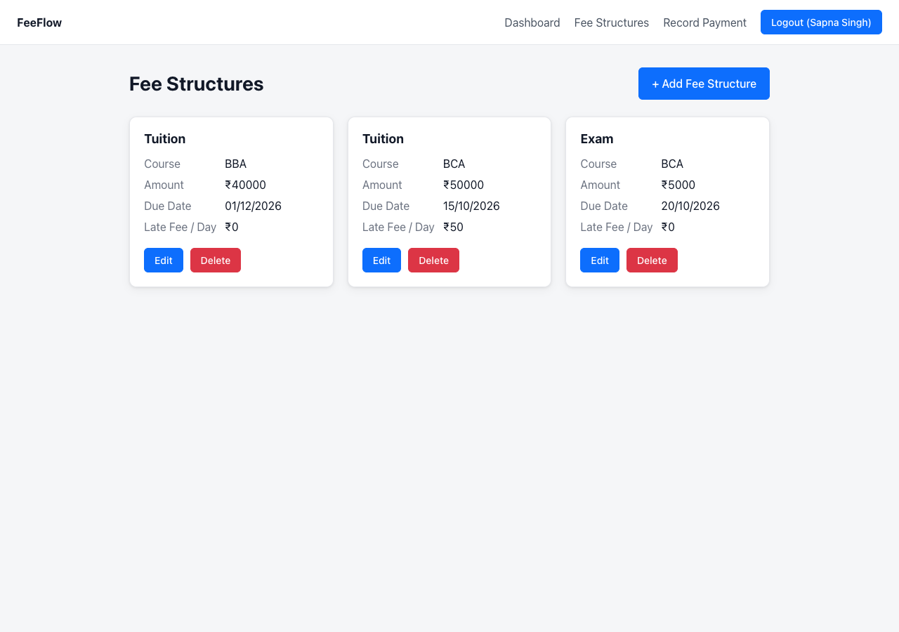
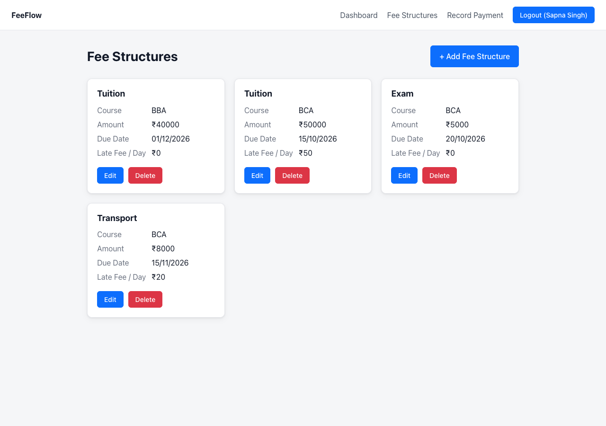
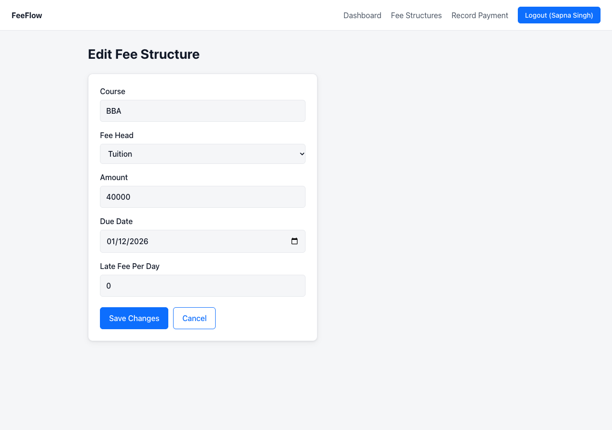
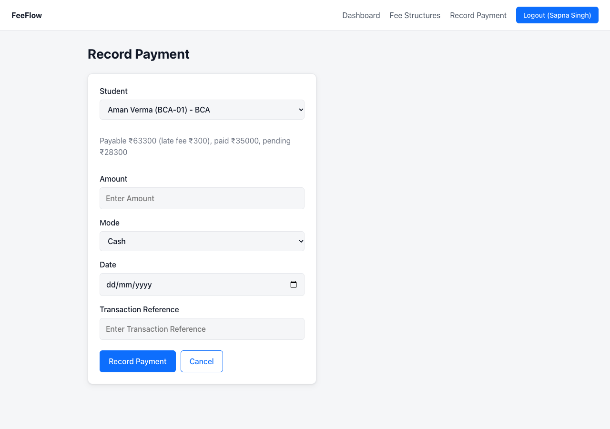
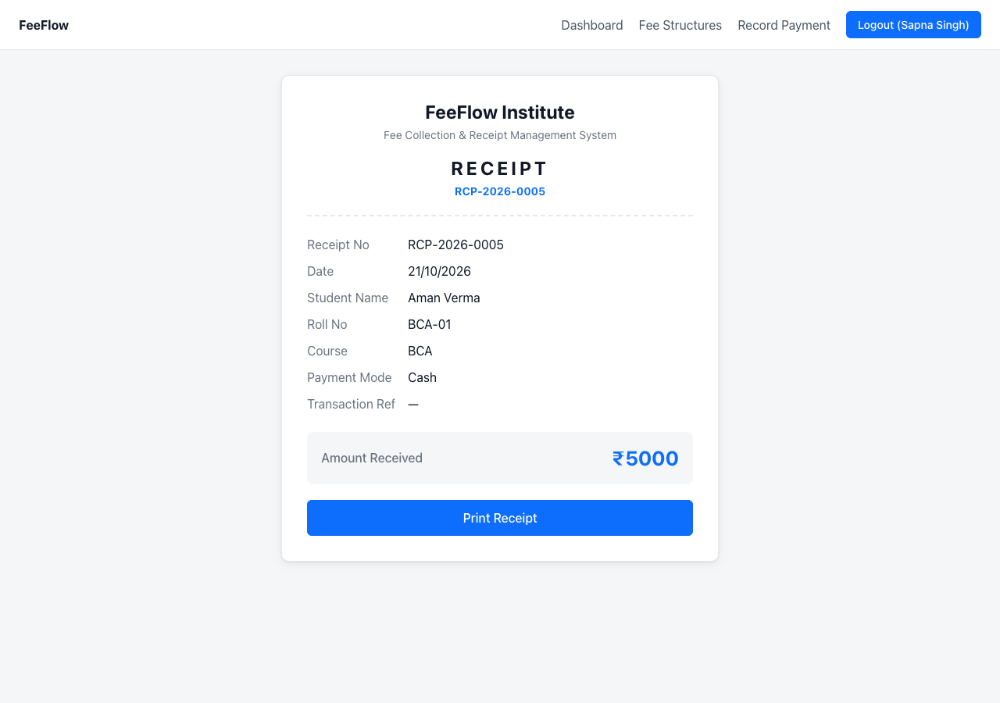
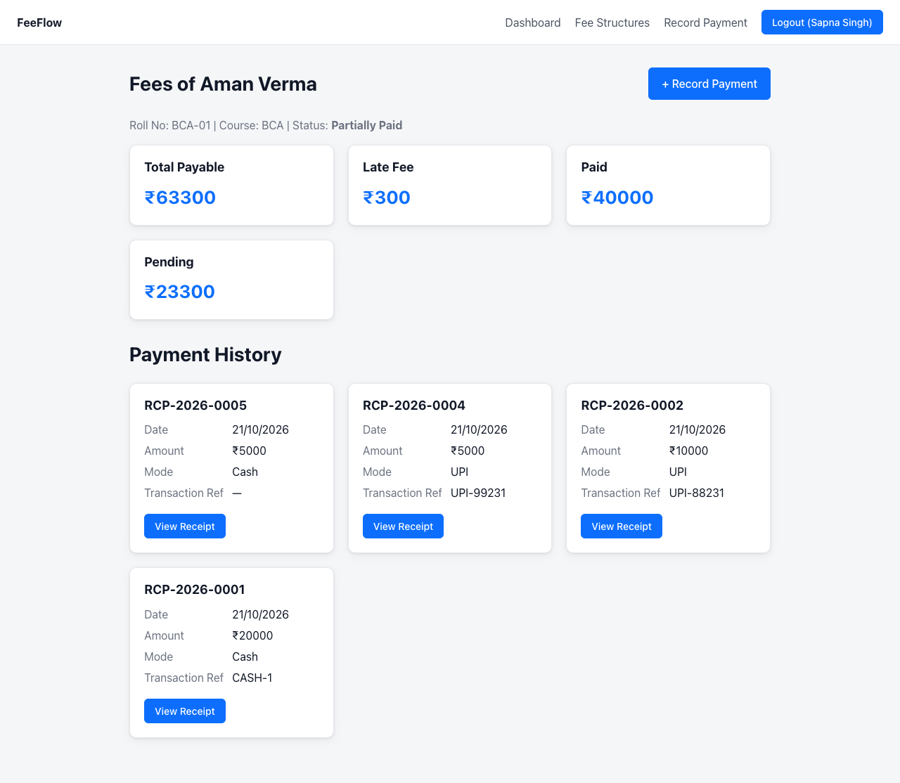
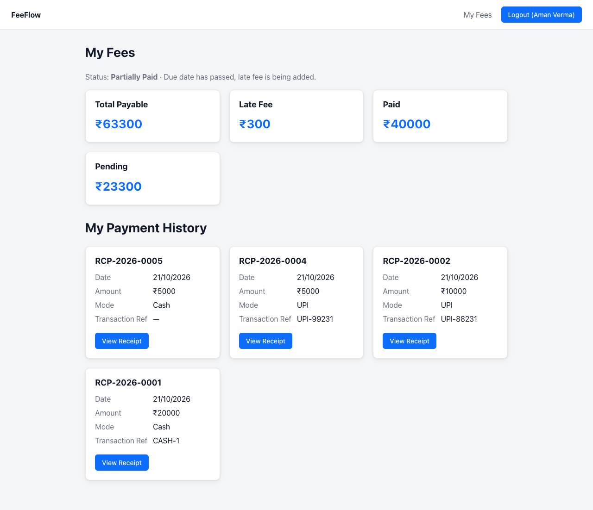

# PS3 - FeeFlow

## Problem Statement

**PS3: Fee Collection & Receipt Management System** — An institute records fee payments, tracks dues and issues receipts. Admin manages fee structures per course and records payments; students view their fee summary, payment history and receipts; a dashboard shows collections, dues and defaulters.

## PS Number

**PS3**

## Project Name

**FeeFlow – Fee Collection & Receipt Management System**

## About

FeeFlow is a role-based fee management app for an institute. An **Admin** (accountant) defines fee structures per course (fee heads like Tuition, Exam, Transport with amount, due date and optional late fee per day), records payments in Cash / UPI / Card, and gets a dashboard of total collected, total pending, overdue defaulters and mode-wise collection. Every payment auto-generates a unique receipt number (`RCP-2026-0001` …) with its own printable receipt page. A **Student** registers with roll number and course, and sees total payable, paid, pending, status (Paid / Partially Paid / Unpaid) and full payment history with receipts.

- Total payable = sum of all fee heads of the student's course **+ late fee** (late fee per day × days after the due date)
- Paid = sum of all payments; Pending = payable − paid; status computed automatically
- A payment of zero, a negative amount, or more than the pending amount is **rejected**
- Partial payments are allowed

## Technologies Used

- **Frontend:** React 19, Vite 8, React Router 8, fetch, oxlint
- **Backend:** Node.js, Express 5, Mongoose 9
- **Database:** MongoDB
- **Auth:** JSON Web Tokens (JWT) + bcryptjs password hashing
- **Other:** cors, dotenv

## APIs Used

No external APIs — the app uses its own REST API built with Express (`/api/*`).

## API Routes

| Method | Route | Description | Access |
| --- | --- | --- | --- |
| POST | `/api/auth/register` | Register (role: student/admin; student stores roll no + course) | Public |
| POST | `/api/auth/login` | Login, returns JWT + user | Public |
| GET | `/api/fees` | List all fee structures | Admin |
| POST | `/api/fees` | Create fee structure (course, fee head, amount, due date, late fee/day) | Admin |
| PUT | `/api/fees/:id` | Update a fee structure | Admin |
| DELETE | `/api/fees/:id` | Delete a fee structure | Admin |
| GET | `/api/students` | List all students | Admin |
| GET | `/api/students/:id/fees` | Student fee summary + payment history (own fees for student) | Admin or the student |
| POST | `/api/payments` | Record a payment (validates zero/negative/over-pending, auto receipt no.) | Admin |
| GET | `/api/payments/receipt/:receiptNo` | Get one receipt (own receipts for student) | Admin or the student |
| GET | `/api/dashboard` | Total collected, total pending, mode-wise collection, overdue defaulters | Admin |

## Pages (React Router)

| Route | Page |
| --- | --- |
| `/` | Redirects by role (admin → dashboard, student → my fees) |
| `/login` | Login |
| `/register` | Register (role select; roll no + course for students) |
| `/admin/dashboard` | Dashboard — totals, mode-wise collection, defaulters, all students |
| `/admin/fees` | Fee structures list (edit / delete) |
| `/admin/fees/new` | Add fee structure |
| `/admin/fees/:id/edit` | Edit fee structure |
| `/admin/payments/new` | Record a payment |
| `/admin/students/:id/fees` | One student's fee summary + history |
| `/my-fees` | Student's own fee summary + history |
| `/receipts/:receiptNo` | Printable receipt |

## Screenshots












## Live Demo

Runs locally (needs MongoDB + the Express backend) — see Installation and Setup below.

## Installation and Setup

1. **Start MongoDB** (default connection `mongodb://127.0.0.1:27017/feeDB`):

   ```bash
   brew services start mongodb-community
   ```

2. **Backend** (port 3000):

   ```bash
   cd backend
   npm install
   cp .env.example .env        # set any JWT_SECRET
   npm start
   ```

3. **Frontend** (port 5173):

   ```bash
   cd frontend
   npm install
   npm run dev
   ```

4. Open **http://localhost:5173** — register an **Admin** account from the Register tab (choose role Admin), add fee structures, then register students and record payments.

Checks: `cd frontend && npm run lint` (oxlint) and `npm run build` (Vite) both run clean.

## Author

**SAPNA SINGH**
